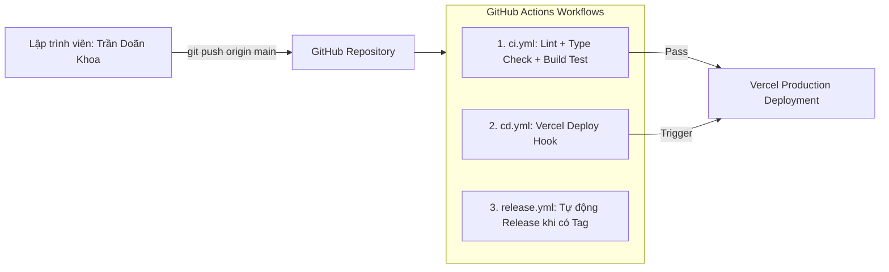

# Hướng dẫn Hệ thống CI/CD — Chinese Notebook

Tài liệu hướng dẫn vận hành hệ thống Tích hợp liên tục (CI) và Triển khai liên tục (CD) tự động cho dự án **Chinese Notebook**.

---

## 1. Tổng quan Kiến trúc CI/CD



Hệ sinh thái CI/CD của Chinese Notebook bao gồm 3 quy trình tự động hóa chính:

| Tên Workflow | File cấu hình | Điều kiện kích hoạt | Mục đích |
| :--- | :--- | :--- | :--- |
| **CI (Continuous Integration)** | `.github/workflows/ci.yml` | `push` / `pull_request` vào nhánh `main` hoặc chạy thủ công | Kiểm tra lỗi cú pháp (Lint), kiểm tra kiểu dữ liệu (TypeScript) và thử nghiệm Build Next.js Production |
| **CD (Continuous Deployment)** | `.github/workflows/cd.yml` | `push` vào nhánh `main` hoặc chạy thủ công | Tự động kích hoạt quy trình triển khai lên môi trường Production trên Vercel |
| **Release Management** | `.github/workflows/release.yml` | `push` Git tag dạng `v*` (ví dụ `v1.0.0`) | Tự động xuất bản GitHub Release chính thức với tên tác giả **Trần Doãn Khoa** và bản quyền © 2026 |

---

## 2. Quy trình Triển khai Vercel (CD)

Hiện tại dự án hỗ trợ 2 phương thức triển khai lên Vercel:

### Phương thức 1: Vercel Git Integration (Khuyến nghị - Tiêu chuẩn cao nhất)
Vercel được liên kết trực tiếp với GitHub Repository `KhoaErez/hoc_tiengtrung`:
* Mỗi khi push commit vào `main`, Vercel tự động kích hoạt Production Deployment.
* Mỗi khi mở Pull Request, Vercel tự động tạo Preview URL riêng biệt để kiểm tra giao diện trước khi merge.
* Workflow `ci.yml` đóng vai trò làm hàng rào chất lượng (Status Check): nếu code bị lỗi TypeScript hoặc Lint, GitHub sẽ cảnh báo để ngăn chặn merge code lỗi.

### Phương thức 2: GitHub Actions Vercel CLI (Tùy chọn)
Nếu anh muốn GitHub Actions trực tiếp điều phối lệnh deploy Vercel qua workflow `cd.yml`, chỉ cần cấu hình 3 biến bí mật trong **GitHub Repository Secrets** (`Settings` -> `Secrets and variables` -> `Actions`):
* `VERCEL_TOKEN`: Token tài khoản Vercel cá nhân (tạo tại [vercel.com/account/tokens](https://vercel.com/account/tokens)).
* `VERCEL_ORG_ID`: ID tài khoản hoặc Team trên Vercel (lấy trong file `.vercel/project.json` sau khi chạy `npx vercel link`).
* `VERCEL_PROJECT_ID`: ID dự án trên Vercel (lấy trong file `.vercel/project.json`).

> *Lưu ý:* Nếu chưa thêm các Secret trên, workflow `cd.yml` sẽ thông báo trạng thái nhẹ nhàng và nhường quyền deploy tự động cho **Vercel Git Integration** mà không gây gián đoạn hệ thống.

---

## 3. Danh sách Biến Môi trường cần thiết trên Vercel

Để website vận hành hoàn hảo trên Production, hãy đảm bảo các biến sau đã được thiết lập trong **Vercel Project Settings -> Environment Variables**:

| Tên Biến | Ý nghĩa | Phạm vi |
| :--- | :--- | :--- |
| `NEXT_PUBLIC_SUPABASE_URL` | URL kết nối dịch vụ Supabase | Production, Preview, Development |
| `NEXT_PUBLIC_SUPABASE_ANON_KEY` | Khóa công khai của Supabase (dùng cho client-side) | Production, Preview, Development |
| `GEMINI_API_KEY` | Khóa bí mật Google Gemini AI (chạy server-side) | Production, Preview |
| `KIE_API_KEY` | Khóa bí mật API KIE AI | Production, Preview |
| `KIE_MODEL` | Tên model AI cấu hình | Production, Preview |
| `KIE_BASE_URL` | Endpoint của hệ thống KIE AI | Production, Preview |

---

## 4. Hướng dẫn Phát hành Phiên bản Mới (Release)

Khi anh muốn đánh dấu một cột mốc phát triển mới (ví dụ phát hành phiên bản `v1.0.0`):

```bash
# 1. Tạo tag phiên bản tại máy cục bộ
git tag v1.0.0 -m "Release v1.0.0: Chinese Notebook chính thức ra mắt"

# 2. Đẩy tag lên GitHub
git push origin v1.0.0
```

Ngay sau khi push tag:
1. GitHub Action `release.yml` sẽ tự động khởi chạy.
2. Tạo ra bản **GitHub Release** mang đầy đủ thông tin:
   - Tên: **Chinese Notebook v1.0.0**
   - Tác giả: **Trần Doãn Khoa**
   - Bản quyền: **© 2026 Trần Doãn Khoa. All rights reserved.**
   - Danh sách tính năng và liên kết pháp lý.
